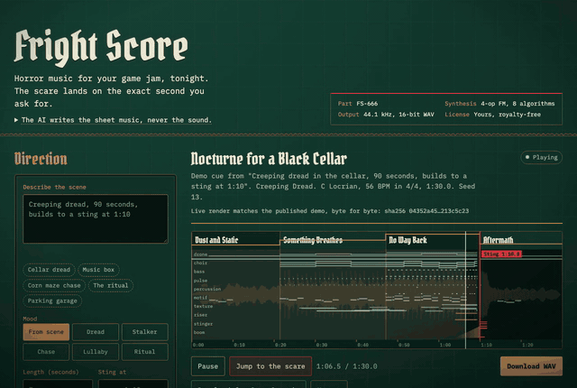
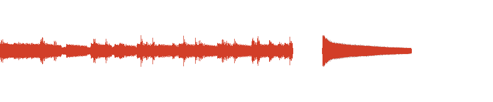
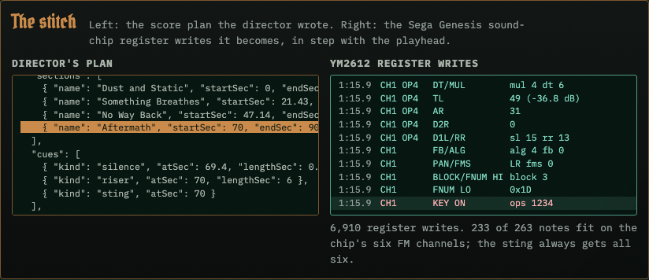
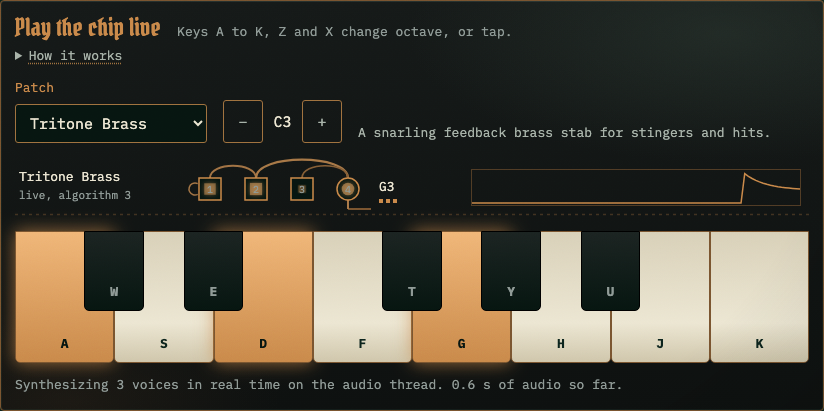

# Fright Score

**The AI writes the sheet music, never the sound.** A score director plans a horror cue, a recreated Sega Genesis
FM chip performs it, and the scare lands on the exact second you ask for.

Offline rules by default, Amazon Bedrock optional. Free, in your browser, with no account.

**Live: [fright-score.pages.dev](https://fright-score.pages.dev/)** · [Judges: 60 seconds](#judges-60-seconds) · [Hear it](#hear-it) · [Built with Kiro](#built-with-kiro) · [Run it](#run-it) · MIT licensed



With sound: [`docs/sting.mp4`](docs/sting.mp4), 12 seconds of the demo cue around the sting (the hit lands 6.5 s in).

## Judges: 60 seconds

1. Open [fright-score.pages.dev](https://fright-score.pages.dev/). The demo cue is already on the board.
2. Turn the sound on and press **Jump to the scare**: six seconds of riser, 0.6 s of silence, then the sting,
   with the blood flash, on 1:10.
3. Scroll to **The scare lands on the event**, press **Enter the hallway**, then open the door (click it or
   press E): the loop cuts, and the page reports "Sting landed 0.600 s after the door opened".
4. Press **Download for Sega Genesis** and open the `.vgm` in any VGM player: the same cue as real YM2612
   register writes. [Hear it played by an independent Genesis emulator](#hear-it).
5. Kiro: 5 specs, 5 steering files (always, fileMatch, manual), 4 kiro-cli hooks, 3 IDE hooks, 1 custom agent, 3 MCP servers including its own.
   See [Built with Kiro](#built-with-kiro).

**Kiro by the numbers:** 16 logged Kiro calls, 194.32 credits, 9,204 lines written by Kiro with 1 line fixed, and
Fright Score's own MCP server called from a Kiro session. Every call is in the [Kiro log](KIRO-LOG.md#summary).

To run it locally instead: `npm install && npm run dev`, then open http://localhost:3120.

## The problem

A solo developer is at hour 60 of a 72-hour horror jam. The cellar level needs a creeping loop, and the cellar
door needs a jump-scare sting that hits when the player opens it.

| | The stock route | The free CC0 route | With Fright Score |
|---|---|---|---|
| What you do | Search AudioJungle, buy a loop and three stingers, trim them in Audacity, line the sting up by hand | Search OpenGameArt, Freesound and itch.io, hope a loop and a sting fit together, cut and line them up in Audacity | `npm run score -- --mood dread --seconds 16 --loop --out cellar-loop.wav`, then `npm run score -- --mood chase --seconds 5 --sting 0:01 --out door-sting.wav`, then drop both into the [Godot add-on](examples/godot) and connect one signal |
| Cost | About **$18 to $48** ([$9](https://audiojungle.net/item/retro-slasher-stalks/25742921) to [$39](https://audiojungle.net/item/horror-rising/23767370) a track, [$3](https://audiojungle.net/item/horror-stinger/54366456) a stinger) | $0, license checked file by file | **$0**, the cues are yours |
| Time to the two files | Search, checkout and editing time | Search and editing time | About **2 seconds** for both commands (1.15 s for the loop, 0.86 s for the sting, wall time on an Apple M4 Max) |
| The sting lands | Where you place it by hand | Where you place it by hand | 0.6 s after the door opens, out of planned silence, measured in Godot at 0.598 s |

Suno's cheapest plan with commercial rights is [Pro, at $10 a month](https://suno.com/pricing), and its free plan has
no commercial rights. Prices checked November 22, 2026.

Horror is one of the biggest genres in indie games: **itch.io lists [113,442 games tagged Horror](https://itch.io/games/tag-horror)**,
and [5,324 tagged both Horror and PSX](https://itch.io/games/tag-horror/tag-psx), whose low-poly look calls for exactly
this era of sound (checked November 22, 2026). A single jam such as [GMTK 2025](https://itch.io/jam/gmtk-2025) drew
9,513 entries in four days.

Also for: horror tabletop and escape-room game masters who need a cue that hits at an exact second every week
(the share link brings last week's cue back byte for byte), and video creators scoring a short horror segment.

## Why it's a Frankenstein

Fright Score stitches together two things from 35 years apart. A director reads a scene and writes a score
plan: key and mode, tempo, sections that build, a motif, and the exact cue points. A recreation of the
four-operator FM chip inside the Sega Genesis (the Yamaha YM2612) performs it. Neither half could make the cue
alone. The director has no sound, and the chip has no idea where the scare goes. The stitch is visible in the
app: the plan's JSON sits beside the register writes it turns into, and any cue exports as a `.vgm` file of
real YM2612 register writes that Genesis emulators and VGM players can play.

What runs today: the default director is a rule-based scene reader plus a seeded Markov composer, offline and
free. The Amazon Bedrock director (Converse API, answering through a typed `score_cue` tool call whose input is
validated with zod) is written, tested with a fake client and switched on with `FRIGHT_DIRECTOR=bedrock`. Both write the same ScorePlan, and the chip never
knows which one wrote it.

## In a game: the scare lands on the event

A jam game does not know at which second the player opens the door. Try it in the browser: the scene **The scare lands
on the event** plays a hallway loop until you open the door, then cuts to silence and lands the sting 0.6 s
later, and shows the offset it measured on the audio clock. Both sounds are rendered cues played back from files,
the same two WAVs the Godot example uses (a test checks the bytes match); only the keyboard is synthesized live.

In Godot, the [add-on](examples/godot) does the same: `$Door.opened.connect($Cue.scare)`. The hallway loop cuts to silence, the sting file starts at
the top of its 0.6 s pre-silence, and the hit lands 0.6 s after the door opens. A headless Godot check
measures it: the hit lands 0.598 s after the event, within one frame.

After any cue renders, **Download Godot pack (.zip)** hands over everything in one file: the add-on, the cue as a
seamless loop, a sting with its hit at 1.0 s, and a README with the two-line setup.

## Hear it

Rendered with the CLI by [`scripts/make-samples.sh`](scripts/make-samples.sh):

- [`cellar-dread-sting-at-1m10s.mp3`](samples/cellar-dread-sting-at-1m10s.mp3): the demo cue, 90 s, sting at 1:10.
- [`music-box-jump-scare-at-40s.mp3`](samples/music-box-jump-scare-at-40s.mp3): a lullaby that breaks at 0:40.
- [`stalker-seamless-loop.mp3`](samples/stalker-seamless-loop.mp3): a 20-second loop for a game level.
- [`cellar-dread-genesis.vgm`](samples/cellar-dread-genesis.vgm): the demo cue for the Sega Genesis (26 KB of
  YM2612 register writes). Open it in any VGM player or Genesis emulator.

**AI-written sheet music, performed by a Sega Genesis sound chip.** The same `.vgm`, played by an independent
emulator, [Game_Music_Emu](https://github.com/libgme/game-music-emu)'s YM2612 core, which knows nothing about Fright
Score and only replays the register writes: [`docs/genesis-proof.mp3`](docs/genesis-proof.mp3) (10 s around the sting,
[with a waveform](docs/genesis-proof.mp4)). The riser, the planned silence and the hit are all there; the hit sounds
at 70.04 s in the emulator against 70.00 s in the plan. Rebuild it with
[`scripts/genesis-proof/make-proof.sh`](scripts/genesis-proof/make-proof.sh).



**Starter pack.** `bash scripts/make-starter-pack.sh` renders 5 seamless loops (one per mood) and 20 short
stings, released under CC0, in under two minutes. [`samples/starter-pack-manifest.csv`](samples/starter-pack-manifest.csv)
lists the request, seed and sha256 of every file, so anyone can rerun it and check they got the same bytes.


| The stitch, just after the sting | The chip, played live |
|---|---|
|  |  |

<details>
<summary>The 60-second tour of the app</summary>

1. Open the app. The demo cue, "Creeping dread in the cellar, 90 seconds, builds to a sting at 1:10", is
   ready to hear within about a second, from a pre-rendered preview. Press **Listen** on the timeline. In the
   background the chip renders the same cue live, and the page shows "Live render matches the published demo,
   byte for byte" with its sha256 when it finishes.
2. Press **Jump to the scare**. In six seconds you hear the riser climb, the board go silent for 0.6 s and
   the sting land. The page flashes blood red, the timeline shakes and the chip's pads flare.
3. Watch **The stitch**: the director's plan as JSON on the left, the Sega Genesis sound-chip register
   writes it becomes on the right, scrolling with the playhead.
4. Type your own scene, or pick a mood (dread, stalker, chase, lullaby, ritual), and press **Summon the
   score**. The render sweeps across the timeline in a few seconds.
5. Press **Download WAV**, tick **Seamless loop for games** for a loop with loop points, or press
   **Download for Sega Genesis**.
6. Press A to K on your keyboard to play the chip yourself, live.

</details>

<details>
<summary>Why now: agents build whole jam games</summary>

AI coding agents now build complete games, and jams are where it shows. [Cursor Vibe Jam 2026](https://vibejam.com)
required at least 90% of the code to be written by AI and drew 945 games; the [2025 Vibe Coding Game Jam](https://vibejam.com/2025/)
drew over 1,000. itch.io's [AI Browser Game Jam](https://itch.io/jam/ai-jam-4) grew from 29 entries in its first round to
121 in its fourth (all checked November 22, 2026).

Those games still need audio an agent can trust: license-clean, timed to the game, and checkable. Fright Score is a score
tool an agent can call. Its [MCP server](#use-it-from-an-agent-mcp) returns the plan, the second each sting lands and the
sha256 of the file, and the same arguments always give the same bytes, so the agent can verify what it got.

It also has no training data. In June 2024 the major record labels sued Suno and Udio over the recordings used to train
their models ([RIAA](https://www.riaa.com/record-companies-bring-landmark-cases-for-responsible-ai-againstsuno-and-udio-in-boston-and-new-york-federal-courts-respectively/)).
Every Fright Score cue comes from music-theory rules, a seeded Markov composer and an FM synthesizer, and anyone can
re-render a cue from its share link and check where it came from.

</details>

<details>
<summary>How it compares</summary>

AI music tools are good, and some already give you real structure: Soundraw sets the energy of each block,
Beatoven.ai sets the mood of each section, and ElevenLabs Music takes a composition plan with a duration for
every section. Use them when you want polished, realistic instruments. Free CC0 libraries are the honest default for a jam: [OpenGameArt](https://opengameart.org/art-search-advanced) lists about 4,300 CC0 music
entries, [Freesound](https://freesound.org/search/?q=horror+stinger) returns 250 sounds for "horror stinger", and itch.io lists
[368 free horror music assets](https://itch.io/game-assets/free/tag-horror/tag-music) (all checked November 22, 2026). They are
recordings: you cannot write a loop and a sting together in one key, land the hit on a set second out of planned silence, or
re-render a file from a seed. Fright Score is for the moment the scare has to land on a set second and the loop has to sit in a
game engine.

| | Fright Score | Song generators (Suno, Udio) | Score generators (Beatoven.ai, Soundraw, ElevenLabs Music) | Stock libraries (AudioJungle, Pond5) | Free CC0 libraries (OpenGameArt, Freesound, itch.io) plus Audacity |
|---|---|---|---|---|---|
| Set the length and the shape of the sections | Yes | Length only, roughly | Yes | No, you edit the track | No, you cut and stretch recordings by hand |
| A sting on the exact second, out of a planned silence | Yes, within 50 ms, after a 0.6 s pre-silence | No | Section durations (3 s minimum on ElevenLabs), not a hit on a set second | No, you edit it in | No, you line it up in an editor |
| Seamless game loop with engine loop points in the WAV | Yes (`smpl` chunk; [Godot example](examples/godot)) | No | Loop points in the file not documented | Some loop versions, sold per track | Some files loop; you set loop points yourself |
| Re-render the exact same file later | Yes, byte for byte from the seed | No | No | Not applicable | Not applicable, a fixed recording |
| Sega Genesis export | Yes (`.vgm` of YM2612 register writes) | No | No | No | No |
| Works offline, no account | Yes, in the browser or the CLI | No | No | Download per purchase | Download per file |
| Cost for commercial use | Free | Suno Pro, $10 a month | Paid plans | About $9 to $39 a track, $3 a stinger | Free (check each file's license) |
| Where the sound comes from | An FM synth, no training data | Neural models trained on recordings (the subject of the 2024 label lawsuits) | Neural models trained on audio | Human composers | Recordings by many contributors, each cut for someone else's project |

</details>

<details>
<summary>Beyond Kiroween: pricing and market</summary>

- **Free core, forever:** the web app, the CLI, WAV, loop and Genesis exports, the local director and the MCP server.
- **Engine Pack, $9 once:** Unity and FMOD plugins (the [Godot add-on](examples/godot) is free and already lands the sting
  on a game event), stems for each layer and game-event sting sets. Paid horror music packs on the Unity Asset Store run
  from [$9.99](https://assetstore.unity.com/packages/package/405226) to [$68](https://assetstore.unity.com/packages/package/20994)
  (checked November 22, 2026, during a sale).
- **Per-cue API and MCP pricing for AI game-building platforms:** a metered, hosted version of the MCP server with the
  Bedrock director, for platforms whose agents generate games.

A bottom-up estimate from the numbers above, as an illustration rather than a forecast: if 1% of the developers behind
itch.io's 113,442 horror games bought the Engine Pack once, that is about 1,130 sales, or about $10,200. On the agent side,
a jam the size of Cursor Vibe Jam 2026 (945 games) at about five cues a game (a loop per level plus stings) is about 4,700
cues; at $0.05 a cue that is about $240 a jam. The bet is the growth of agent-built games, not one jam.

</details>

<details>
<summary>Every feature, in detail</summary>

- The page opens on a real cue: the "Cellar dread" demo plays at once from a pre-rendered preview, with a
  **Listen** button that names when the scare lands and a **Jump to the scare** button that starts six seconds
  before it. The live render finishes in the background, playback carries on in it from the same spot, and the
  page checks its sha256 against the published hash (a unit test checks that the CLI renders exactly that hash).
- Type a scene ("Creeping dread in the cellar, 90 seconds, builds to a sting at 1:10") or pick one of five
  moods: dread, stalker, chase, lullaby, ritual. The app shows what it understood as you type.
- The director turns it into a plan you can read: key and mode (Phrygian, Locrian, octatonic and more), tempo,
  sections with rising intensity, a Markov-composed motif, and cue points. Stings land within 50 ms of the
  requested time, out of a deliberate 0.6 s silence, after a riser and a racing heartbeat.
- When the playhead crosses a sting, the page reacts for 600 ms: a blood vignette, a two-frame shake with a
  chromatic split, the operator pads flaring and a red playhead. Under reduced motion it is a still red frame.
- The **FS-666** renders it: four-operator FM with all eight YM2612-style algorithms, operator-1 feedback,
  five-stage envelopes, LFO, pitch glides, ten horror patches, reverb and a mastering chain.
- Cues are rendered in a Web Worker by the same engine as the CLI, then played back sample-exact, so what
  you hear is byte for byte the file you download. While a cue plays, each channel's operators light up with
  the envelope levels recorded during the render, copper traces show the algorithm, the scope shows the
  output audio, and the vignette deepens with the intensity of the section.
- **The stitch:** the director's plan as JSON beside the YM2612 register writes of the same cue, in step with
  the playhead, named the way the chip's datasheet names them.
- **Sega Genesis export:** every patch is mapped onto YM2612 registers (algorithm, feedback, MUL, DT, TL and
  envelope rates fitted to the chip's rate table), the score is arranged for six FM channels (the sting always
  gets all six), and the result is a VGM 1.50 file with sample-accurate timing and loop points for loops.
- **Play the chip live:** a keyboard (on screen, or A to K) drives the FS-666 in real time in an
  AudioWorklet on the audio thread. Pick any of the eleven patches and watch its operators and envelopes
  respond as you play. It runs the same operator code as the renderer, sample for sample.
- **Levels that fit the mood:** every cue is measured for integrated loudness (ITU-R BS.1770) and trimmed to
  its mood's ceiling, from -14 LUFS for a chase to -18 LUFS for a lullaby, under a -3 dBTP true peak.
- **Download WAV** (44.1 kHz, 16-bit, stereo, -3 dBTP true-peak ceiling, a 0.3 s fade-in and a clean fade-out)
  or the score as JSON.
- **Seamless loops for games:** whole bars, no fades, release tails wrapped onto the start, and loop points in
  the WAV (`smpl` chunk) that game engines and samplers read. The in-app player fades a loop in when it
  starts.
- **Same request and seed, same bytes.** The browser and the CLI produce identical files, and the share link
  reproduces the exact cue on any machine.
- **Accessible:** the timeline is a keyboard slider, errors appear next to their field, controls meet WCAG
  contrast, and on phones the cue comes before the form.
- **CLI** for batch scoring: `npm run score -- --mood dread --seconds 90 --seed 7 --out cue.wav`.

</details>

## Run it

Requires Node 20 or newer.

```bash
npm install
npm run dev            # http://localhost:3120
```

Production build and preview:

```bash
npm run build
npm run preview        # http://localhost:3121
```

### CLI

```bash
npm run score -- --mood dread --seconds 90 --seed 7 --out cue.wav
npm run score -- --scene "A music box winds down in the nursery, 45 seconds, jump scare at 0:40" --out lullaby.wav
npm run score -- --mood chase --seconds 30 --sting 0:24 --seed 3 --out chase.wav --json chase.json
npm run score -- --mood stalker --seconds 20 --loop --out stalker-loop.wav
npm run score -- --mood ritual --seconds 60 --sting 0:50 --out ritual.wav --vgm ritual.vgm
npm run score -- --help
```

Output: 44.1 kHz, 16-bit stereo PCM WAV, true peak at or below -3 dBFS, integrated loudness at or below the
mood's ceiling (chase -14, ritual -15, dread and stalker -16, lullaby -18 LUFS), a 0.3 s fade-in that keeps the
first 50 ms at least 20 dB under the cue's peak, and a fade-out (the fade-out never starts before a late sting
lands). The CLI prints the loudness it measured, and it matches `ffmpeg -af ebur128` within 0.2 LU.

A 90-second cue renders in seconds. `npm run bench` times the demo cue from request to WAV bytes; on an Apple
M4 Max under heavy load (load average 67) it measured a median of 6.7 s, 13.5 times faster than real time.

### Use it from an agent (MCP)

<details>
<summary>Register the server and call <code>score_cue</code></summary>

Fright Score ships a Model Context Protocol server, so an agent such as a Kiro session can ask for a cue and
check it. It speaks JSON-RPC over stdio, needs no account and no network, and always uses the local director
(rules and a seeded Markov composer, not an AI model), whatever `FRIGHT_DIRECTOR` says. When the Bedrock director
is used elsewhere, the model writes the plan (the sheet music) and the FS-666 chip makes the sound; the MCP server
has no model in it at all.

Register it in `.kiro/settings/mcp.json`, next to any other servers:

```json
"fright-score": {
  "command": "npx",
  "args": ["tsx", "scripts/mcp/fright-score-mcp.ts"],
  "timeout": 120000
}
```

The server has four tools, one prompt and one resource:

- `list_patches` takes no arguments and returns the eleven FS-666 instruments (`id`, `name`, `blurb`, `algorithm`,
  `feedback`) in library order.
- `score_cue` renders a cue and returns the plan, the second each sting lands, and the SHA-256 of the WAV.
- `score_level` renders a whole game level: one seamless loop per room and one sting per event (see below).
- `verify_cue` measures a rendered `.wav` and reports where each sting lands (see below).
- The prompt `score_scene_for_game` walks an agent through the job, and the resource `fright-score://moods` lists
  every mood with its tempo range and loudness ceiling.

| `score_cue` argument | Meaning |
|---|---|
| `scene` | Scene description, up to 500 characters. Sting times written in it ("a sting at 1:10") are read as in the CLI. |
| `mood` | One of the moods listed by `npm run score -- --help`. |
| `durationSec` | 5 to 300. |
| `stingAtSec` | Up to eight times in seconds, each above 0 and at most 300. |
| `seed` | Integer, 0 to 4,294,967,295. Default 13. Same arguments and seed always give the same `sha256`. |
| `writeWavTo` | Optional. A new `.wav` path inside the server's working folder. The server refuses an existing file, a path outside the folder and any other extension. Without it, no file is written. |

A sample result for `{ "mood": "chase", "durationSec": 30, "stingAtSec": [24], "seed": 3 }` (the plan is shortened
here):

```json
{
  "director": "local",
  "seed": 3,
  "durationSec": 30,
  "stingLandingSec": [24],
  "sha256": "3e289fecc70aa4e968ef6ebf59ed8683fe41d2c40749af73aa63e98900d6908d",
  "wavBytes": 5292044,
  "plan": { "title": "Requiem for the Chapel", "mood": "chase", "tempoBpm": 169, "...": "..." }
}
```

`sha256` equals the hash of the file `npm run score -- --mood chase --seconds 30 --sting 24 --seed 3` writes. Bad
arguments come back as a tool result with `isError: true`, so the agent can read the message and retry.

#### Score a whole level

The agent plans the rooms and events; the local director writes each score and the FS-666 makes every sound.
`score_level` renders, for 1 to 8 rooms, one seamless loop per room and one 5 s sting file per event. The same
arguments and seed always give the same hashes, and a file does not change when other rooms or events are added.

| `score_level` argument | Meaning |
|---|---|
| `rooms` | 1 to 8 rooms, each `{ id, mood, loopSec, events }`. `id` is lower case letters, digits and underscores, starting with a letter (up to 32 characters). `mood` is one of the moods in `fright-score://moods`. `loopSec` is 4 to 60. `events` has up to 8 entries, each `{ id, scene? }` with a scene of up to 500 characters. Ids must be unique (event ids within a room). |
| `seed` | Integer, 0 to 4,294,967,295. Default 13. |
| `writeDir` | Optional. A new folder inside the server's working folder. The server saves `<room>.loop.wav`, `<room>.<event>.sting.wav` and `manifest.json` there, and refuses a folder that exists or lies outside the working folder. |

Every sting file puts its hit at `hitSec` (1 s). Play it from `startFromSec` (0.4 s) and the hit sounds 0.6 s
later (`hitAfterStartSec`). A sting time written in a scene text does not move the hit. A sample result (hashes
shortened):

```json
{
  "director": "local",
  "seed": 7,
  "rooms": [
    {
      "id": "hallway",
      "mood": "stalker",
      "loop": { "sha256": "444b98aa...", "wavBytes": 1210216, "durationSec": 6.86, "loopStartSample": 0, "loopEndSample": 302525 },
      "events": [
        { "id": "door_opened", "sha256": "2aa89466...", "wavBytes": 882044, "durationSec": 5, "hitSec": 1, "startFromSec": 0.4, "hitAfterStartSec": 0.6 }
      ]
    }
  ]
}
```

`verify_cue` reads a 16-bit PCM `.wav` inside the working folder (at most 64 MB) and takes `wavPath`,
`expectedHitSec` (1 to 16 times) and `toleranceMs` (1 to 1000, default 50). It finds each onset, a sharp rise in
short-window level over the 0.5 s of quiet before it (a rendered cue has a quiet reverb tail, not digital silence),
and pairs every expected time with the nearest onset within 0.5 s. Each result has `measuredSec`, `errorMs` and
`pass`; `measuredSec` is `null` when no onset is near. The golden cue above measures 24 s within 50 ms.

The prompt `score_scene_for_game` takes the optional string arguments `game` and `writeDir` (up to 200 characters
each) and tells the agent to read `fright-score://moods`, call `score_level`, then call `verify_cue` on every
written sting. The resource `fright-score://moods` is JSON with one entry per mood: `id`, `label`, `tagline`,
`tempoBpm` (`min`, `max`) and `loudnessCeilingLufs`. `examples/godot/level.json` and `level-manifest.json` show a
two-room level and its manifest.

</details>

<details>
<summary>Test it</summary>

```bash
npx playwright install chromium   # once
npm test                          # typecheck + unit + CLI + end-to-end
npm run test:unit                 # Vitest: engine, score, director, WAV, Genesis export, CLI
npm run test:e2e                  # Playwright against the built app (port 3122, or set E2E_PORT)
npm run test:live                 # smoke test of the deployed site (set LIVE_URL for a preview deploy)
```

The unit suite checks the FM math (sine table accuracy, envelope timing, operator pitch, FM sidebands,
feedback, all eight algorithms), the score schema, scene parsing, determinism by seed, sting timing within
50 ms, the true-peak ceiling, the opening level of every mood, BS.1770 loudness (reference coefficients, the
-3.01 LUFS sine, gating), mood loudness ceilings, fades, the WAV header and length, the live chip core
(sample-for-sample equal to the offline voice, release, polyphony, no clipping), and the Genesis export
(tuning within one cent, register mapping, the envelope rate model, the sting keying on at its exact sample,
loop points). Sample tests check that the committed samples and the Godot example are exactly what the CLI
exports today.

The end-to-end tests drive the real app: the demo cue is ready on first load, the Listen overlay and Jump to
the scare, the sting payoff and its reduced-motion version, the atmosphere following the cue, summon a cue,
play it, export the WAV and parse it, confirm the browser export equals the CLI export byte for byte, open a
share link in a fresh page and get the same file, export a loop with loop points, export and parse a VGM,
the stitch panel at the sting, keyboard scrubbing, inline form errors, the phone layout, and play the live
chip so the AudioWorklet reports voices and real output.

</details>

<details>
<summary>Architecture, adapters and deploy</summary>

```
 request ──> Director ──> ScorePlan ──> reconcile ──> Arranger ──> Score ──> FS-666 engine ──> master ──> WAV
 (scene,     local |       (zod)        (length,      (seeded,     (notes)   (Web Worker       (limiter,  (16-bit,
  mood,      bedrock |                   stings)       per-role)              or Node CLI)      -3 dBTP)   dither)
  seed)      remote                                                  │
                                                                     └──> YM2612 mapping ──> six-channel arrangement ──> VGM

 keyboard ──> LiveChip ──> AudioWorklet (LiveChipCore: same Voice / Operator / Envelope) ──> analyser ──> speakers
```

| Folder | What lives there |
|---|---|
| `src/engine/` | The chip: sine table, envelope, operator, 8 algorithms, voice, patches, reverb, master, loudness, renderer |
| `src/score/` | Schemas, music theory, seeded RNG, scene reader, local composer (Markov motifs), arranger |
| `src/director/` | Director interface and adapters: local, Amazon Bedrock, remote |
| `src/export/` | Sega Genesis export: YM2612 register mapping, six-channel arrangement, VGM writer and parser |
| `src/wav/` | WAV encoder and parser |
| `src/cli/` | `npm run score` |
| `scripts/mcp/` | The MCP server (`fright-score-mcp.ts`) and its two tools (`tools.ts`) |
| `src/server/`, `functions/` | `/api/compose` handler and its Cloudflare Pages Function |
| `src/web/` | Browser app: form, render worker, player, timeline, chip view, stitch panel, scope |
| `src/web/live/` | The real-time chip: AudioWorklet processor, its testable core, page-side controller |
| `examples/godot/` | A Godot 4 project and add-on: a loop with no code, and a sting that lands on a game event, with headless checks |
| `samples/` | Listening samples and a VGM, rendered by `scripts/make-samples.sh` |
| `tests/` | `unit/`, `cli/`, `e2e/` |

The engine has no DOM dependency, so the browser worker and the CLI run exactly the same code.

### Adapters: local and real

| Service | Default (free, offline) | Real path (written and type-checked, not run by default) | Switch |
|---|---|---|---|
| Score director | `LocalDirector`: rule-based scene reader plus seeded Markov composer | `BedrockDirector`: Amazon Bedrock Converse API answers through a typed `score_cue` tool call, validated with zod, one repair round | `FRIGHT_DIRECTOR=bedrock` (CLI) |
| Web score director | `LocalDirector` in the browser | `RemoteDirector` POSTs to `/api/compose`, a Pages Function that runs the Bedrock director server-side | `VITE_FRIGHT_DIRECTOR=remote` at build time |

Whatever the director returns, `reconcilePlan` forces the requested length and sting times, and the same
schema validates it, so an AI plan can never break the renderer. Tests use fake clients; no test calls a
paid service. See `.env.example`.

### Deploy

Static hosting on **Cloudflare Pages** (free tier): build command `npm run build`, output folder `dist`.
The optional `/api/compose` function in `functions/` needs AWS credentials as Pages secrets.

</details>

## Built with Kiro

**Kiro by the numbers:** see the [summary table at the top of KIRO-LOG.md](KIRO-LOG.md#summary).

| Kiro feature | Files | What it does here |
|---|---|---|
| Specs | [`.kiro/specs/fright-score-core/`](.kiro/specs/fright-score-core), [`.kiro/specs/live-chip/`](.kiro/specs/live-chip), [`.kiro/specs/director-tools/`](.kiro/specs/director-tools), [`.kiro/specs/door-scene/`](.kiro/specs/door-scene), [`.kiro/specs/agent-scoring/`](.kiro/specs/agent-scoring) | EARS requirements, a design and a task plan for the director, arranger, engine, WAV, CLI, web app and loudness; the real-time AudioWorklet keyboard; the Bedrock tool call and MCP server; the browser door scene; and scoring a whole game level from an agent. Kiro wrote the last three and built them. |
| Steering | [`.kiro/steering/`](.kiro/steering) | Product, tech and structure rules Kiro loads for every task: determinism by seed, the adapter rule, units in names, the folder map. `engine-dsp.md` loads only when engine or live-chip files are in context (hot-loop and determinism rules); `export-formats.md` is pulled in by hand for WAV `smpl` and VGM work. |
| Hooks | [`.kiro/hooks/`](.kiro/hooks) | `test-on-save` runs the unit tests when engine, score, director, WAV or live-chip code is saved. `determinism-guard` blocks unseeded randomness (`Math.random`, `Date.now`) in engine and composer code. `spec-task-sync` is an agent hook that checks off finished tasks and asks for a green suite before the agent stops. `render-bench` is run on demand and times the demo render after an engine change. |
| Custom agent | [`.kiro/agents/fs666-sound-designer.json`](.kiro/agents/fs666-sound-designer.json) | A patch-design agent: loads the tech, engine and export steering plus the patch bank, and its permission rules allow writes only to engine code and unit tests and commands only for the typecheck, tests, determinism check, benchmark and CLI. In session 12 it designed the `theremin-lead` patch with its tests. Its limit probes went through, because this repo's headless runner trusts `fs_write` and `run_command` for every session; the log records it. A unit test keeps every hook, steering file and agent resource pointing at files and scripts that exist. |
| Spec built by Kiro, MCP | [`.kiro/specs/director-tools/`](.kiro/specs/director-tools), [`scripts/mcp/`](scripts/mcp), [`KIRO-LOG.md`](KIRO-LOG.md), pass 3 | Kiro wrote the spec and built all 24 tasks in three sessions (18.24 credits): the Bedrock director's forced `score_cue` tool call and the stdio MCP server with `score_cue` and `list_patches`, 41 new tests, and 99% of the feature's lines. It used the aws-docs and context7 MCP servers while designing, then called its own server from a new session. |
| Kiro scored the video soundtrack | [`KIRO-LOG.md`](KIRO-LOG.md), session 10 | Kiro called `score_level` on [`examples/godot/level.json`](examples/godot/level.json) (hashes equal to the committed manifest) and scored the demo video's soundtrack with `score_cue`, then checked each sting with `verify_cue`. See [Scored for the video soundtrack](#scored-for-the-video-soundtrack). |
| Agent run with sub-agents | [`KIRO-LOG.md`](KIRO-LOG.md), pass 2 | Kiro CLI audited both specs against the code with two sub-agents, rewrote every acceptance criterion in strict EARS form, added 27 tasks for behaviors no test pinned down, built the candlelit theme and its reduced-motion test, and validated the hooks against the v1 schema (29.38 credits). |

[`KIRO-LOG.md`](KIRO-LOG.md) records every Kiro call, its prompt, what it produced and the credits it used.

### Scored for the video soundtrack

Kiro scored both cues of the demo video's soundtrack through Fright Score's MCP server, then measured the cold
open's sting with `verify_cue` (7.001 s against 7 s). Anyone can re-render them byte for byte with the same
request and seed:

| Cue | Request | Seed | Title | Sting | sha256 |
|---|---|---|---|---|---|
| Cold open | `{"scene": "A cellar door creaks open in the dark, 8 seconds, sting at 0:07"}` | 13 | The Rotten Door | 7 s | `45a15a259877477101d9019dff9576041daea960b2adc669c1b176815d3b88e2` |
| Bed | `{"mood": "dread", "durationSec": 165}` | 666 | Requiem for the Lantern | none | `f7dc0c42efcf69105b4fb59449b573e94221d7b14889d30f14d5015ea946afc6` |

End card text: "This video's soundtrack was written by Kiro through Fright Score's MCP server and performed by a 1988-style
sound chip. Re-render it byte for byte."

## License

MIT, by Stubborn Otter Software. Cues you render are yours to use anywhere, royalty-free.
