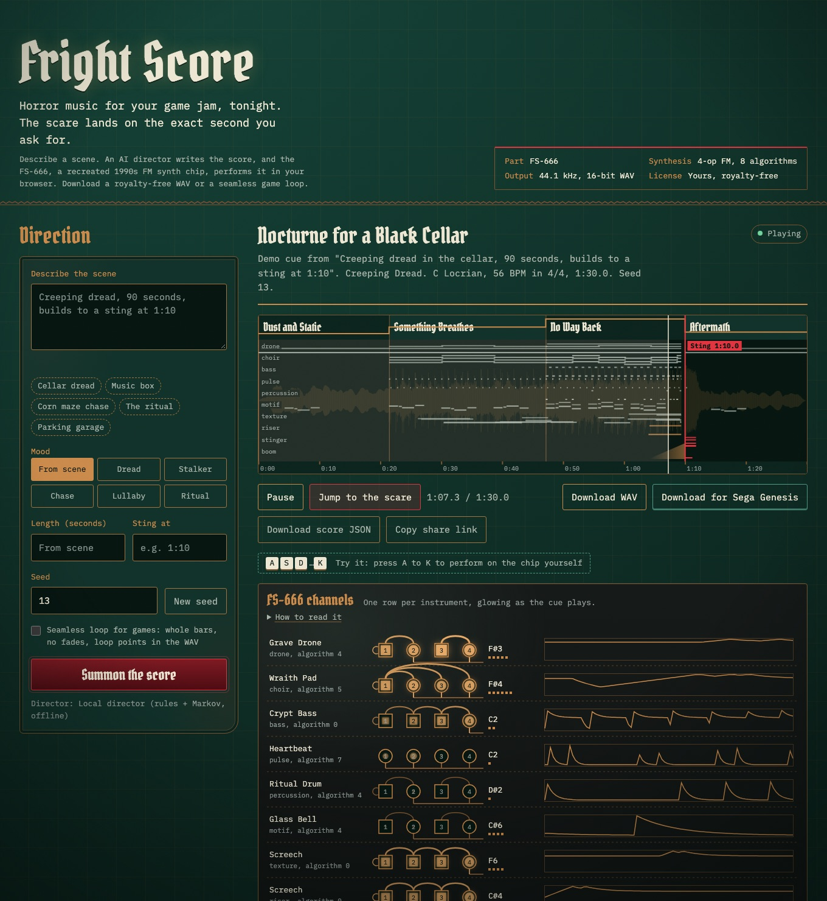

# Fright Score

**Live: [fright-score.pages.dev](https://fright-score.pages.dev/)** (runs entirely in your browser with the free local director; the optional Bedrock director is not deployed there).

**Horror music for your game jam, tonight: a director writes the score, a haunted 1990s FM synth chip
performs it, and the scare lands on the exact second you ask for.**

Type a scene, such as "A music box winds down in the nursery, 45 seconds, jump scare at 0:40". Fright Score
writes an original horror cue for it and renders the cue in your browser on the FS-666, a recreated
four-operator FM chip. You get a royalty-free WAV, a seamless game loop or a Sega Genesis file. The sting
lands within 50 ms of the time you typed.

**The AI writes the sheet music, never the sound.** The director only produces a score plan: key, tempo,
sections and cue points. By default that director is a rule-based scene reader with a seeded Markov
composer, so it runs offline in your browser for free; switch on Amazon Bedrock and a language model writes
the same plan instead. Either way, every sound comes from an FM chip recreation that has never heard a
recording.


With sound: [`docs/sting.mp4`](docs/sting.mp4), 12 seconds of the demo cue around the sting, the screen capture
muxed with the exact WAV the CLI renders (the hit lands 6.5 s in).

[Judges: 60 seconds](#judges-60-seconds) · [Hear the samples](#hear-it) · [Run it](#run-it) · [Built with Kiro](#built-with-kiro) · MIT licensed

## Judges: 60 seconds

1. Open [fright-score.pages.dev](https://fright-score.pages.dev/) (or run it: `npm install && npm run dev`, then
   open http://localhost:3120). The demo cue is already on the board.
2. Turn the sound on and press **Jump to the scare**: six seconds of riser, 0.6 s of silence, then the sting,
   with the blood flash, on 1:10.
3. Press **Download for Sega Genesis** and open the `.vgm` in any VGM player: the same cue as real YM2612
   register writes.
4. Kiro: 4 specs, 5 steering files (always, fileMatch, manual), 4 kiro-cli hooks, 3 IDE hooks, 1 custom agent, 3 MCP servers including its own.
   See [Built with Kiro](#built-with-kiro).

## The problem

It is hour 60 of a 72-hour horror game jam. The cellar level needs a creeping loop, and the door slam needs
a jump-scare sting that hits on cue, tonight. The track you found on a video site has unclear rights. Stock
libraries sell music and stingers one at a time. An AI song generator returns a song with no control over
when the scare lands, and Suno's free plan carries no commercial rights.

What that costs today: on AudioJungle, a horror music track is
[$9](https://audiojungle.net/item/retro-slasher-stalks/25742921) to
[$39](https://audiojungle.net/item/horror-rising/23767370) under its standard license, and a single stinger
sound effect is [$3](https://audiojungle.net/item/horror-stinger/54366456), so one loop and three stingers come to
about **$18 to $48**. Suno's cheapest plan with commercial rights is [Pro, at $10 a month](https://suno.com/pricing).
Fright Score is **$0**, with no account. (Prices checked November 18, 2026.)

Horror is one of the biggest genres in indie games: **itch.io lists [112,036 games tagged Horror](https://itch.io/games/tag-horror)**
(November 2026), and a single jam such as [GMTK 2025](https://itch.io/jam/gmtk-2025/results) drew 9,513 entries in four
days. Most of these games come from solo developers and small jam teams with no audio budget.

## Who it is for

- **Retro and PSX-style horror developers.** itch.io lists
  [5,268 games tagged both Horror and PSX](https://itch.io/games/tag-horror/tag-psx) (November 2026). Their low-poly,
  low-fidelity look calls for period-correct sound, and an FM chip from the Sega Genesis era is exactly that.
  The `.vgm` export goes one step further, to homebrew Genesis games.
- **Game jam teams** who need a creeping loop and a sting that lands on cue before the deadline.
- **Horror tabletop and escape-room game masters** who run a session every week and need a cue that builds
  and hits at an exact second, such as the lights dying at 0:32 when the players open the cellar. A new seed
  gives a new cue each week; the share link brings back last week's cue byte for byte.
- **Video creators and streamers** scoring a short horror segment or a trailer.

## The 60-second tour

1. Open the app. The demo cue, "Creeping dread in the cellar, 90 seconds, builds to a sting at 1:10", is
   ready to hear within about a second, from a pre-rendered preview. Press **Listen** on the timeline. In the
   background the chip renders the same cue live, and the page shows "Live render matches the published demo,
   byte for byte" with its sha256 when it finishes.
2. Press **Jump to the scare**. In six seconds you hear the riser climb, the board go silent for 0.6 s and
   the sting land. The page flashes blood red, the timeline shakes and the chip's pads flare.
3. Watch **The stitch**: the director's plan as JSON on the left, the Sega Genesis sound-chip register
   writes it becomes on the right, scrolling with the playhead.
4. Type your own scene, or pick a mood (dread, stalker, chase, lullaby, ritual), and press **Summon the
   score**. The render sweeps across the timeline in a few seconds.
5. Press **Download WAV**, tick **Seamless loop for games** for a loop with loop points, or press
   **Download for Sega Genesis**.
6. Press A to K on your keyboard to play the chip yourself, live.

## Why it's a Frankenstein

Fright Score stitches together two things from 35 years apart. A director reads a scene and writes a score
plan: key and mode, tempo, sections that build, a motif, and the exact cue points. A recreation of the
four-operator FM chip inside the Sega Genesis (the Yamaha YM2612) performs it. Neither half could make the cue
alone. The director has no sound, and the chip has no idea where the scare goes. The stitch is visible in the
app: the plan's JSON sits beside the register writes it turns into, and any cue exports as a `.vgm` file of
real YM2612 register writes that Genesis emulators and VGM players can play.

What runs today: the default director is a rule-based scene reader plus a seeded Markov composer, offline and
free. The Amazon Bedrock director (Converse API, answering through a typed `score_cue` tool call whose input is
validated with zod) is written, tested with a fake client and switched on with `FRIGHT_DIRECTOR=bedrock`. Both write the same ScorePlan, and the chip never
knows which one wrote it.

## Why now

In June 2024 the major record labels sued Suno and Udio over the recordings used to train their models
([RIAA](https://www.riaa.com/record-companies-bring-landmark-cases-for-responsible-ai-againstsuno-and-udio-in-boston-and-new-york-federal-courts-respectively/)).
Fright Score has no training data. Every cue comes from music-theory rules, a seeded Markov composer and an
FM synthesizer. The same request and seed give the same file, byte for byte, on any machine. Anyone can
re-render a cue from its share link and check where it came from.

## How it compares

AI music tools are good, and some already give you real structure: Soundraw sets the energy of each block,
Beatoven.ai sets the mood of each section, and ElevenLabs Music takes a composition plan with a duration for
every section. Use them when you want polished, realistic instruments. Fright Score is for the moment the
scare has to land on a set second and the loop has to sit in a game engine.

| | Fright Score | Song generators (Suno, Udio) | Score generators (Beatoven.ai, Soundraw, ElevenLabs Music) | Stock libraries (AudioJungle, Pond5) |
|---|---|---|---|---|
| Set the length and the shape of the sections | Yes | Length only, roughly | Yes | No, you edit the track |
| A sting on the exact second, out of a planned silence | Yes, within 50 ms, after a 0.6 s pre-silence | No | Section durations (3 s minimum on ElevenLabs), not a hit on a set second | No, you edit it in |
| Seamless game loop with engine loop points in the WAV | Yes (`smpl` chunk; [Godot example](examples/godot)) | No | Loop points in the file not documented | Some loop versions, sold per track |
| Re-render the exact same file later | Yes, byte for byte from the seed | No | No | Not applicable |
| Sega Genesis export | Yes (`.vgm` of YM2612 register writes) | No | No | No |
| Works offline, no account | Yes, in the browser or the CLI | No | No | Download per purchase |
| Cost for commercial use | Free | Suno Pro, $10 a month | Paid plans | About $9 to $39 a track, $3 a stinger |
| Where the sound comes from | An FM synth, no training data | Neural models trained on recordings (the subject of the 2024 label lawsuits) | Neural models trained on audio | Human composers |

## In a game: the scare lands on the event

A jam game does not know at which second the player opens the door. The [Godot add-on](examples/godot)
handles that: `$Door.opened.connect($Cue.scare)`. The hallway loop cuts to silence, the sting file starts at
the top of its 0.6 s pre-silence, and the hit lands 0.6 s after the door opens. A headless Godot check
measures it: the hit lands 0.598 s after the event, within one frame.

## Hear it

Rendered with the CLI by [`scripts/make-samples.sh`](scripts/make-samples.sh):

- [`cellar-dread-sting-at-1m10s.mp3`](samples/cellar-dread-sting-at-1m10s.mp3): the demo cue, 90 s, sting at 1:10.
- [`music-box-jump-scare-at-40s.mp3`](samples/music-box-jump-scare-at-40s.mp3): a lullaby that breaks at 0:40.
- [`stalker-seamless-loop.mp3`](samples/stalker-seamless-loop.mp3): a 20-second loop for a game level.
- [`cellar-dread-genesis.vgm`](samples/cellar-dread-genesis.vgm): the demo cue for the Sega Genesis (26 KB of
  YM2612 register writes). Open it in any VGM player or Genesis emulator.

**Starter pack.** `bash scripts/make-starter-pack.sh` renders 5 seamless loops (one per mood) and 20 short
stings, released under CC0, in under two minutes. [`samples/starter-pack-manifest.csv`](samples/starter-pack-manifest.csv)
lists the request, seed and sha256 of every file, so anyone can rerun it and check they got the same bytes.



| The stitch, just after the sting | The chip, played live |
|---|---|
|  |  |

## Kiroween 2026

- **Category:** Frankenstein. A score director (rules by default, Amazon Bedrock when switched on) stitched to a
  recreated 1990s FM chip, with a Sega Genesis export.
- **Built with Kiro:** specs with EARS requirements, steering, hooks, a custom agent, MCP servers and a Kiro-built feature. See
  [Built with Kiro](#built-with-kiro) and [`KIRO-LOG.md`](KIRO-LOG.md).
- **AWS:** the director has an Amazon Bedrock adapter (Converse API, validated with zod) and a Cloudflare
  Pages Function for it. The free local director is the default.

## Beyond Kiroween

Priced against what a jam team pays today (about $18 to $48 for one loop and three stingers on a stock site,
or $10 a month for Suno Pro):

- **Free, forever:** the web app, the CLI, WAV, loop and Genesis exports, and the local director.
- **Pro, $4 a month:** stems for each layer, game-event stings for engines, mood packs and Bedrock-directed
  cues. Less than half of Suno Pro, and less than one stock track.
- **Game master pack, $2 a month:** a saved weekly session, one loop and three stings per scene, each on its
  own seed, re-rendered byte for byte whenever the group returns.
- **Engine plugins:** the [Godot add-on](examples/godot) already loops an export with no code and lands the sting
  when the player opens the door; Unity and FMOD next.
- **Market:** 112,036 horror games on itch.io, 5,268 of them PSX-style, and jams of nearly 10,000 entries that
  each need audio by the deadline.
- **Retro scene:** VGM export opens the door to homebrew Genesis games and chiptune artists.

## What works today

<details>
<summary>Every feature, in detail</summary>

- The page opens on a real cue: the "Cellar dread" demo plays at once from a pre-rendered preview, with a
  **Listen** button that names when the scare lands and a **Jump to the scare** button that starts six seconds
  before it. The live render finishes in the background, playback carries on in it from the same spot, and the
  page checks its sha256 against the published hash (a unit test checks that the CLI renders exactly that hash).
- Type a scene ("Creeping dread in the cellar, 90 seconds, builds to a sting at 1:10") or pick one of five
  moods: dread, stalker, chase, lullaby, ritual. The app shows what it understood as you type.
- The director turns it into a plan you can read: key and mode (Phrygian, Locrian, octatonic and more), tempo,
  sections with rising intensity, a Markov-composed motif, and cue points. Stings land within 50 ms of the
  requested time, out of a deliberate 0.6 s silence, after a riser and a racing heartbeat.
- When the playhead crosses a sting, the page reacts for 600 ms: a blood vignette, a two-frame shake with a
  chromatic split, the operator pads flaring and a red playhead. Under reduced motion it is a still red frame.
- The **FS-666** renders it: four-operator FM with all eight YM2612-style algorithms, operator-1 feedback,
  five-stage envelopes, LFO, pitch glides, ten horror patches, reverb and a mastering chain.
- Cues are rendered in a Web Worker by the same engine as the CLI, then played back sample-exact, so what
  you hear is byte for byte the file you download. While a cue plays, each channel's operators light up with
  the envelope levels recorded during the render, copper traces show the algorithm, the scope shows the
  output audio, and the vignette deepens with the intensity of the section.
- **The stitch:** the director's plan as JSON beside the YM2612 register writes of the same cue, in step with
  the playhead, named the way the chip's datasheet names them.
- **Sega Genesis export:** every patch is mapped onto YM2612 registers (algorithm, feedback, MUL, DT, TL and
  envelope rates fitted to the chip's rate table), the score is arranged for six FM channels (the sting always
  gets all six), and the result is a VGM 1.50 file with sample-accurate timing and loop points for loops.
- **Play the chip live:** a keyboard (on screen, or A to K) drives the FS-666 in real time in an
  AudioWorklet on the audio thread. Pick any of the ten patches and watch its operators and envelopes
  respond as you play. It runs the same operator code as the renderer, sample for sample.
- **Levels that fit the mood:** every cue is measured for integrated loudness (ITU-R BS.1770) and trimmed to
  its mood's ceiling, from -14 LUFS for a chase to -18 LUFS for a lullaby, under a -3 dBTP true peak.
- **Download WAV** (44.1 kHz, 16-bit, stereo, -3 dBTP true-peak ceiling, a 0.3 s fade-in and a clean fade-out)
  or the score as JSON.
- **Seamless loops for games:** whole bars, no fades, release tails wrapped onto the start, and loop points in
  the WAV (`smpl` chunk) that game engines and samplers read. The in-app player fades a loop in when it
  starts.
- **Same request and seed, same bytes.** The browser and the CLI produce identical files, and the share link
  reproduces the exact cue on any machine.
- **Accessible:** the timeline is a keyboard slider, errors appear next to their field, controls meet WCAG
  contrast, and on phones the cue comes before the form.
- **CLI** for batch scoring: `npm run score -- --mood dread --seconds 90 --seed 7 --out cue.wav`.

</details>

## Run it

Requires Node 20 or newer.

```bash
npm install
npm run dev            # http://localhost:3120
```

Production build and preview:

```bash
npm run build
npm run preview        # http://localhost:3121
```

### CLI

```bash
npm run score -- --mood dread --seconds 90 --seed 7 --out cue.wav
npm run score -- --scene "A music box winds down in the nursery, 45 seconds, jump scare at 0:40" --out lullaby.wav
npm run score -- --mood chase --seconds 30 --sting 0:24 --seed 3 --out chase.wav --json chase.json
npm run score -- --mood stalker --seconds 20 --loop --out stalker-loop.wav
npm run score -- --mood ritual --seconds 60 --sting 0:50 --out ritual.wav --vgm ritual.vgm
npm run score -- --help
```

Output: 44.1 kHz, 16-bit stereo PCM WAV, true peak at or below -3 dBFS, integrated loudness at or below the
mood's ceiling (chase -14, ritual -15, dread and stalker -16, lullaby -18 LUFS), a 0.3 s fade-in that keeps the
first 50 ms at least 20 dB under the cue's peak, and a fade-out (the fade-out never starts before a late sting
lands). The CLI prints the loudness it measured, and it matches `ffmpeg -af ebur128` within 0.2 LU.

A 90-second cue renders in seconds. `npm run bench` times the demo cue from request to WAV bytes; on an Apple
M4 Max under heavy load (load average 67) it measured a median of 6.7 s, 13.5 times faster than real time.

### Use it from an agent (MCP)

Fright Score ships a Model Context Protocol server, so an agent such as a Kiro session can ask for a cue and
check it. It speaks JSON-RPC over stdio, needs no account and no network, and always uses the local director
(rules and a seeded Markov composer, not an AI model), whatever `FRIGHT_DIRECTOR` says. When the Bedrock director
is used elsewhere, the model writes the plan (the sheet music) and the FS-666 chip makes the sound; the MCP server
has no model in it at all.

Register it in `.kiro/settings/mcp.json`, next to any other servers:

```json
"fright-score": {
  "command": "npx",
  "args": ["tsx", "scripts/mcp/fright-score-mcp.ts"],
  "timeout": 120000
}
```

The server has two tools:

- `list_patches` takes no arguments and returns the ten FS-666 instruments (`id`, `name`, `blurb`, `algorithm`,
  `feedback`) in library order.
- `score_cue` renders a cue and returns the plan, the second each sting lands, and the SHA-256 of the WAV.

| `score_cue` argument | Meaning |
|---|---|
| `scene` | Scene description, up to 500 characters. Sting times written in it ("a sting at 1:10") are read as in the CLI. |
| `mood` | One of the moods listed by `npm run score -- --help`. |
| `durationSec` | 5 to 300. |
| `stingAtSec` | Up to eight times in seconds, each above 0 and at most 300. |
| `seed` | Integer, 0 to 4,294,967,295. Default 13. Same arguments and seed always give the same `sha256`. |
| `writeWavTo` | Optional. A new `.wav` path inside the server's working folder. The server refuses an existing file, a path outside the folder and any other extension. Without it, no file is written. |

A sample result for `{ "mood": "chase", "durationSec": 30, "stingAtSec": [24], "seed": 3 }` (the plan is shortened
here):

```json
{
  "director": "local",
  "seed": 3,
  "durationSec": 30,
  "stingLandingSec": [24],
  "sha256": "3e289fecc70aa4e968ef6ebf59ed8683fe41d2c40749af73aa63e98900d6908d",
  "wavBytes": 5292044,
  "plan": { "title": "Requiem for the Chapel", "mood": "chase", "tempoBpm": 169, "...": "..." }
}
```

`sha256` equals the hash of the file `npm run score -- --mood chase --seconds 30 --sting 24 --seed 3` writes. Bad
arguments come back as a tool result with `isError: true`, so the agent can read the message and retry.

## Test it

```bash
npx playwright install chromium   # once
npm test                          # typecheck + unit + CLI + end-to-end
npm run test:unit                 # Vitest: engine, score, director, WAV, Genesis export, CLI
npm run test:e2e                  # Playwright against the built app (port 3122, or set E2E_PORT)
```

The unit suite checks the FM math (sine table accuracy, envelope timing, operator pitch, FM sidebands,
feedback, all eight algorithms), the score schema, scene parsing, determinism by seed, sting timing within
50 ms, the true-peak ceiling, the opening level of every mood, BS.1770 loudness (reference coefficients, the
-3.01 LUFS sine, gating), mood loudness ceilings, fades, the WAV header and length, the live chip core
(sample-for-sample equal to the offline voice, release, polyphony, no clipping), and the Genesis export
(tuning within one cent, register mapping, the envelope rate model, the sting keying on at its exact sample,
loop points). Sample tests check that the committed samples and the Godot example are exactly what the CLI
exports today.

The end-to-end tests drive the real app: the demo cue is ready on first load, the Listen overlay and Jump to
the scare, the sting payoff and its reduced-motion version, the atmosphere following the cue, summon a cue,
play it, export the WAV and parse it, confirm the browser export equals the CLI export byte for byte, open a
share link in a fresh page and get the same file, export a loop with loop points, export and parse a VGM,
the stitch panel at the sting, keyboard scrubbing, inline form errors, the phone layout, and play the live
chip so the AudioWorklet reports voices and real output.

## Architecture

```
 request ──> Director ──> ScorePlan ──> reconcile ──> Arranger ──> Score ──> FS-666 engine ──> master ──> WAV
 (scene,     local |       (zod)        (length,      (seeded,     (notes)   (Web Worker       (limiter,  (16-bit,
  mood,      bedrock |                   stings)       per-role)              or Node CLI)      -3 dBTP)   dither)
  seed)      remote                                                  │
                                                                     └──> YM2612 mapping ──> six-channel arrangement ──> VGM

 keyboard ──> LiveChip ──> AudioWorklet (LiveChipCore: same Voice / Operator / Envelope) ──> analyser ──> speakers
```

| Folder | What lives there |
|---|---|
| `src/engine/` | The chip: sine table, envelope, operator, 8 algorithms, voice, patches, reverb, master, loudness, renderer |
| `src/score/` | Schemas, music theory, seeded RNG, scene reader, local composer (Markov motifs), arranger |
| `src/director/` | Director interface and adapters: local, Amazon Bedrock, remote |
| `src/export/` | Sega Genesis export: YM2612 register mapping, six-channel arrangement, VGM writer and parser |
| `src/wav/` | WAV encoder and parser |
| `src/cli/` | `npm run score` |
| `scripts/mcp/` | The MCP server (`fright-score-mcp.ts`) and its two tools (`tools.ts`) |
| `src/server/`, `functions/` | `/api/compose` handler and its Cloudflare Pages Function |
| `src/web/` | Browser app: form, render worker, player, timeline, chip view, stitch panel, scope |
| `src/web/live/` | The real-time chip: AudioWorklet processor, its testable core, page-side controller |
| `examples/godot/` | A Godot 4 project and add-on: a loop with no code, and a sting that lands on a game event, with headless checks |
| `samples/` | Listening samples and a VGM, rendered by `scripts/make-samples.sh` |
| `tests/` | `unit/`, `cli/`, `e2e/` |

The engine has no DOM dependency, so the browser worker and the CLI run exactly the same code.

## Adapters: local and real

| Service | Default (free, offline) | Real path (written and type-checked, not run by default) | Switch |
|---|---|---|---|
| Score director | `LocalDirector`: rule-based scene reader plus seeded Markov composer | `BedrockDirector`: Amazon Bedrock Converse API answers through a typed `score_cue` tool call, validated with zod, one repair round | `FRIGHT_DIRECTOR=bedrock` (CLI) |
| Web score director | `LocalDirector` in the browser | `RemoteDirector` POSTs to `/api/compose`, a Pages Function that runs the Bedrock director server-side | `VITE_FRIGHT_DIRECTOR=remote` at build time |

Whatever the director returns, `reconcilePlan` forces the requested length and sting times, and the same
schema validates it, so an AI plan can never break the renderer. Tests use fake clients; no test calls a
paid service. See `.env.example`.

## Deploy

Static hosting on **Cloudflare Pages** (free tier): build command `npm run build`, output folder `dist`.
The optional `/api/compose` function in `functions/` needs AWS credentials as Pages secrets.

## Built with Kiro

| Kiro feature | Files | What it does here |
|---|---|---|
| Specs | [`.kiro/specs/fright-score-core/`](.kiro/specs/fright-score-core), [`.kiro/specs/live-chip/`](.kiro/specs/live-chip) | EARS requirements, a design and a task plan for the director, arranger, engine, WAV, CLI, web app and loudness, and for the real-time AudioWorklet keyboard and the first-load demo cue. |
| Steering | [`.kiro/steering/`](.kiro/steering) | Product, tech and structure rules Kiro loads for every task: determinism by seed, the adapter rule, units in names, the folder map. `engine-dsp.md` loads only when engine or live-chip files are in context (hot-loop and determinism rules); `export-formats.md` is pulled in by hand for WAV `smpl` and VGM work. |
| Hooks | [`.kiro/hooks/`](.kiro/hooks) | `test-on-save` runs the unit tests when engine, score, director, WAV or live-chip code is saved. `determinism-guard` blocks unseeded randomness (`Math.random`, `Date.now`) in engine and composer code. `spec-task-sync` is an agent hook that checks off finished tasks and asks for a green suite before the agent stops. `render-bench` is run on demand and times the demo render after an engine change. |
| Custom agent | [`.kiro/agents/fs666-sound-designer.json`](.kiro/agents/fs666-sound-designer.json) | A patch-design agent: loads the tech, engine and export steering plus the patch bank, may write only engine code and unit tests, and may run only the typecheck, tests, determinism check, benchmark and CLI. A unit test keeps every hook, steering file and agent resource pointing at files and scripts that exist. |
| Spec built by Kiro, MCP | [`.kiro/specs/director-tools/`](.kiro/specs/director-tools), [`scripts/mcp/`](scripts/mcp), [`KIRO-LOG.md`](KIRO-LOG.md), pass 3 | Kiro wrote the spec and built all 24 tasks in three sessions (18.24 credits): the Bedrock director's forced `score_cue` tool call and the stdio MCP server with `score_cue` and `list_patches`, 41 new tests, and 99% of the feature's lines. It used the aws-docs and context7 MCP servers while designing, then called its own server from a new session. |
| Agent run with sub-agents | [`KIRO-LOG.md`](KIRO-LOG.md), pass 2 | Kiro CLI audited both specs against the code with two sub-agents, rewrote every acceptance criterion in strict EARS form, added 27 tasks for behaviors no test pinned down, built the candlelit theme and its reduced-motion test, and validated the hooks against the v1 schema (29.38 credits). |

[`KIRO-LOG.md`](KIRO-LOG.md) records every Kiro call, its prompt, what it produced and the credits it used.

## License

MIT, by Stubborn Otter Software. Cues you render are yours to use anywhere, royalty-free.
