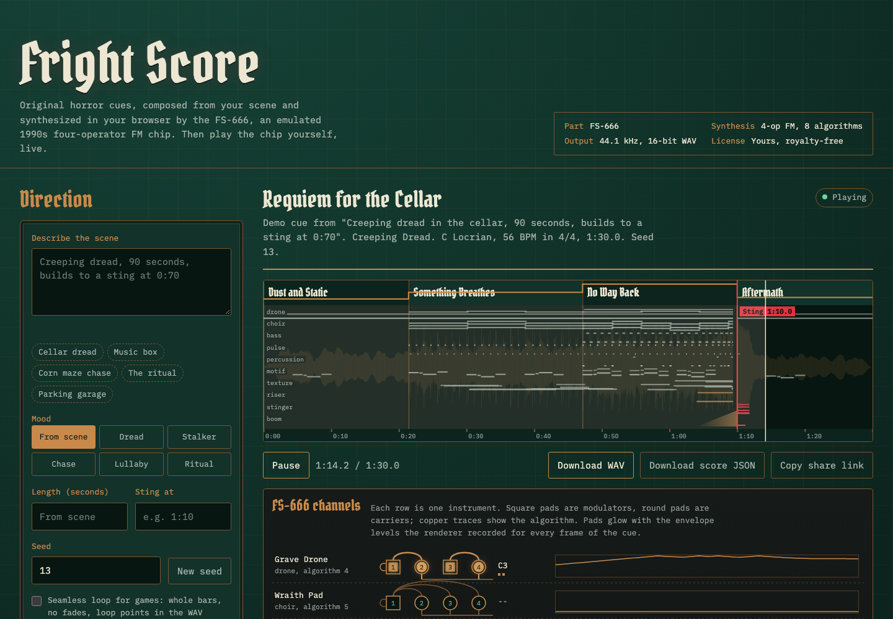

# Fright Score

**Describe a scene, get an original horror score.** An AI director writes the plan, an emulated 1990s FM
synthesis chip renders it in your browser, and you download the result as a royalty-free WAV. Then play the
chip yourself, in real time.



## Who it is for

- **Indie game developers** who need a creepy loop or a stinger tonight, without licensing risk.
- **Video creators, streamers and podcasters** scoring a horror segment or trailer.
- **Escape-room and tabletop hosts** who want a cue that builds to a scare at an exact second.
- **Hackathon teams** scoring their demo videos from the command line (we score ours with it).

## What works today

- The page opens on a real cue: the "Cellar dread" demo renders in about two seconds, ready to play.
- Type a scene ("Creeping dread in the cellar, 90 seconds, builds to a sting at 0:70") or pick one of five
  moods: dread, stalker, chase, lullaby, ritual. The app shows what it understood as you type.
- The director turns it into a plan you can read: key and mode (Phrygian, Locrian, octatonic and more), tempo,
  sections with rising intensity, a Markov-composed motif, and cue points. Stings land within 50 ms of the
  requested time, out of a deliberate 0.6 s silence, after a riser and a racing heartbeat.
- The **FS-666** renders it: four-operator FM with all eight YM2612-style algorithms, operator-1 feedback,
  five-stage envelopes, LFO, pitch glides, ten horror patches, reverb and a mastering chain.
- Cues are rendered in a Web Worker by the same engine as the CLI, then played back sample-exact, so what
  you hear is byte for byte the file you download. While a cue plays, each channel's operators light up with
  the envelope levels recorded during the render, copper traces show the algorithm, the scope shows the
  output audio, and a timeline shows every note and cue.
- **Play the chip live:** a keyboard (on screen, or A to K) drives the FS-666 in real time in an
  AudioWorklet on the audio thread. Pick any of the ten patches and watch its operators and envelopes
  respond as you play. It runs the same operator code as the renderer, sample for sample.
- **Levels that fit the mood:** every cue is measured for integrated loudness (ITU-R BS.1770) and trimmed to
  its mood's ceiling, from -14 LUFS for a chase to -18 LUFS for a lullaby, under a -1 dBTP true peak.
- **Download WAV** (44.1 kHz, 16-bit, stereo, -1 dBTP true-peak ceiling, clean fades) or the score as JSON.
- **Seamless loops for games:** whole bars, no fades, release tails wrapped onto the start, and loop points in
  the WAV (`smpl` chunk) that game engines and samplers read.
- **Same request and seed, same bytes.** The browser and the CLI produce identical files, and the share link
  reproduces the exact cue on any machine.
- **CLI** for batch scoring: `npm run score -- --mood dread --seconds 90 --seed 7 --out cue.wav`.

## Run it

Requires Node 20 or newer.

```bash
npm install
npm run dev            # http://localhost:3120
```

Production build and preview:

```bash
npm run build
npm run preview        # http://localhost:3121
```

### CLI

```bash
npm run score -- --mood dread --seconds 90 --seed 7 --out cue.wav
npm run score -- --scene "A music box winds down in the nursery, 45 seconds, jump scare at 0:40" --out lullaby.wav
npm run score -- --mood chase --seconds 30 --sting 0:24 --seed 3 --out chase.wav --json chase.json
npm run score -- --mood stalker --seconds 20 --loop --out stalker-loop.wav
npm run score -- --help
```

Output: 44.1 kHz, 16-bit stereo PCM WAV, true peak at or below -1 dBFS, integrated loudness at or below the
mood's ceiling (chase -14, ritual -15, dread and stalker -16, lullaby -18 LUFS), fade-in and fade-out (the
fade-out never starts before a late sting lands). A 90-second cue renders in about 2 seconds. The CLI
prints the loudness it measured, and it matches `ffmpeg -af ebur128` within 0.2 LU.

## Test it

```bash
npx playwright install chromium   # once
npm test                          # typecheck + unit + CLI + end-to-end
npm run test:unit                 # Vitest: engine, score, director, WAV, CLI
npm run test:e2e                  # Playwright against the built app (ports 3122)
```

The unit suite checks the FM math (sine table accuracy, envelope timing, operator pitch, FM sidebands,
feedback, all eight algorithms), the score schema, scene parsing, determinism by seed, sting timing within
50 ms, the true-peak ceiling, BS.1770 loudness (reference coefficients, the -3.01 LUFS sine, gating), mood
loudness ceilings, fades, the WAV header and length, and the live chip core (sample-for-sample equal to the
offline voice, release, polyphony, no clipping). The end-to-end tests drive the real app: the demo cue is
ready on first load, summon a cue, play it, export the WAV and parse it, confirm the browser export equals
the CLI export byte for byte, open a share link in a fresh page and get the same file, export a loop with
loop points, and play the live chip so the AudioWorklet reports voices and real output.

## Architecture

```
 request ──> Director ──> ScorePlan ──> reconcile ──> Arranger ──> Score ──> FS-666 engine ──> master ──> WAV
 (scene,     local |       (zod)        (length,      (seeded,     (notes)   (Web Worker       (limiter,  (16-bit,
  mood,      bedrock |                   stings)       per-role)              or Node CLI)      -1 dBTP)   dither)
  seed)      remote

 keyboard ──> LiveChip ──> AudioWorklet (LiveChipCore: same Voice / Operator / Envelope) ──> analyser ──> speakers
```

| Folder | What lives there |
|---|---|
| `src/engine/` | The chip: sine table, envelope, operator, 8 algorithms, voice, patches, reverb, master, loudness, renderer |
| `src/score/` | Schemas, music theory, seeded RNG, scene reader, local composer (Markov motifs), arranger |
| `src/director/` | Director interface and adapters: local, Amazon Bedrock, remote |
| `src/wav/` | WAV encoder and parser |
| `src/cli/` | `npm run score` |
| `src/server/`, `functions/` | `/api/compose` handler and its Cloudflare Pages Function |
| `src/web/` | Browser app: form, render worker, player, timeline, chip view, scope |
| `src/web/live/` | The real-time chip: AudioWorklet processor, its testable core, page-side controller |
| `tests/` | `unit/`, `cli/`, `e2e/` |

The engine has no DOM dependency, so the browser worker and the CLI run exactly the same code.

## Adapters: local and real

| Service | Default (free, offline) | Real path (written and type-checked, not run by default) | Switch |
|---|---|---|---|
| AI director | `LocalDirector`: rule-based scene reader plus seeded Markov composer | `BedrockDirector`: Amazon Bedrock Converse API returns ScorePlan JSON, validated with zod, one repair round | `FRIGHT_DIRECTOR=bedrock` (CLI) |
| Web AI director | `LocalDirector` in the browser | `RemoteDirector` POSTs to `/api/compose`, a Pages Function that runs the Bedrock director server-side | `VITE_FRIGHT_DIRECTOR=remote` at build time |

Whatever the director returns, `reconcilePlan` forces the requested length and sting times, and the same
schema validates it, so an AI plan can never break the renderer. Tests use fake clients; no test calls a
paid service. See `.env.example`.

## Deploy

Static hosting on **Cloudflare Pages** (free tier): build command `npm run build`, output folder `dist`.
The optional `/api/compose` function in `functions/` needs AWS credentials as Pages secrets. Not deployed
from this repository.

## Built with Kiro

- [`.kiro/steering/`](.kiro/steering): product, tech and structure rules that Kiro loads for every task
  (determinism by seed, the adapter rule, units in names, the folder map).
- [`.kiro/specs/`](.kiro/specs): two specs, each with EARS requirements, a design and a task plan the
  implementation follows: `fright-score-core` (director, arranger, engine, WAV, CLI, web app, loudness) and
  `live-chip` (the real-time AudioWorklet keyboard and the demo cue on first load).
- [`.kiro/hooks/`](.kiro/hooks): three hooks. `test-on-save.json` runs the unit tests when engine, score,
  director, WAV or live-chip code is saved; `determinism-guard.json` blocks unseeded randomness
  (`Math.random`, `Date.now`) in engine and composer code; `spec-task-sync.json` is an agent hook that keeps
  the task lists checked off and the suite green before the agent stops.
- [`KIRO-LOG.md`](KIRO-LOG.md): every Kiro CLI call, its prompt, what it produced and what it reported.

## License

MIT, by Stubborn Otter Software. Cues you render are yours to use anywhere, royalty-free.
